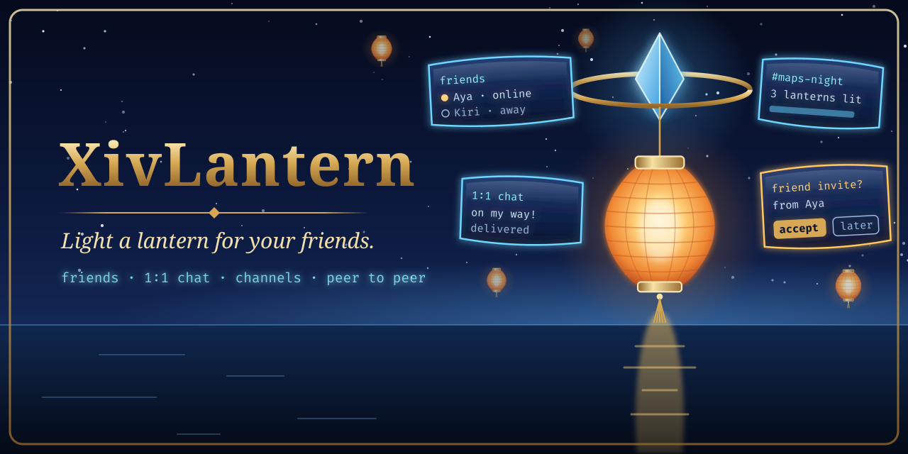

# XivLantern

<p align="center">
  <picture>
    <source media="(prefers-color-scheme: dark)" srcset="images/readme/hero-dark.png">
    <source media="(prefers-color-scheme: light)" srcset="images/readme/hero-light.png">
    
  </picture>
</p>


**[Site](https://spacegho.st/mods/ffxiv/xivlantern/) · [Install](https://spacegho.st/mods/ffxiv/plugins/) · [Vote on what's next](https://spacegho.st/mods/ffxiv/xivlantern/vote/) · [Screenshots](https://spacegho.st/mods/ffxiv/term/gallery/?mod=xivlantern) · [Changelog](CHANGELOG.md)**

Lanterns for FINAL FANTASY XIV: friends light a lantern to say they are here.
A friend list with presence, 1:1 chat and channels, peer to peer over
[iroh](https://www.iroh.computer/), plus an opt-in channel where the mod's
author posts signed announcements and players can write back. A Dalamud plugin
(`/lantern`, or `/xivlantern`) over a Rust network layer (`lantern.dll`).

> **Status: not yet verified in game.** Linux host tests cover the network
> layer, its C ABI, the C# binding, and the plugin's logic. In-progress vote
> features have separate implementation and verification gates in
> [docs/accepted-votes.json](docs/accepted-votes.json).
> An earlier Windows build of the network layer passed its selftest and talked to a
> native node under a stock Wine 11 in a container ([docs/WINE.md](docs/WINE.md)).
> The current vote-preview build has not passed Windows/Wine verification:
> its disposable Wine prefix setup times out before the DLL test runs.
> The plugin compiles against Dalamud 15; in-game behavior remains unverified.
> `/lantern selftest` in game is the next proof. This is the required
> direction, not a claim that it works.

## What it does

* **Friends by invite.** Make a one-time invite, send it privately; whoever
  uses it first becomes your friend, on both sides. Nothing is ever accepted
  for you. Presence (online, away, busy, invisible, and a note you type).
* **1:1 chat** that waits: a message to someone offline goes out when they are
  next online, and you see when it arrives.
* **Up for it tags.** Choose maps, roulettes, crafting, ex or chat, or type
  your own activity. Filter friends by a matching activity; offline friends
  do not expose tags. Tags never come from game state. This local vote
  implementation is included in the checked, unreleased preview package.
  Native peer, binding and mixed-version tests pass; Windows/Wine and game UI
  verification remain pending.
* **Channels** you make and invite friends into. Anyone holding a channel's
  ticket can join and read it.
* **The author channel** (opt in): announcements signed with a key that never
  leaves the author's machine, checked before they are shown, and a way to
  write to the author. See [docs/AUTHOR.md](docs/AUTHOR.md).
* **Safety.** Block (silently), mute, per-person rate limits, size limits, no
  auto-accept.
* **Toasts and a server info bar entry**, following your mutes.
  Hover the server-bar entry for up to eight friends, sorted online first,
  with their statuses and short notes. Longer lists show how many remain;
  offline friends' old notes are omitted. Settings can hide names and notes
  from this tooltip while keeping counts visible, or hide the entire entry.
  Clicking still opens Lantern. Tooltip formatting is host-tested; game
  rendering remains unverified.
* **Friend folders** are local to your configuration. Right-click a friend to
  move them into a named folder or Ungrouped. Collapsible folder headers show
  the online/total count; right-click a header to mute or unmute all current
  members. Individual friend mutes remain in effect when a friend moves.
  Assignments use node IDs, so a reinstalled friend with a new ID is ungrouped.
  Folder names and assignments are never transmitted. In-game UI verification
  is still pending.
* **Safety words** are in a friend's context menu. Both peers see the same
  four words derived from their node IDs. Compare them in a separate trusted
  conversation, then use **Mark compared** to add a local verified mark.
  A full comparison fingerprint is also available to copy. Changing either
  node ID invalidates the mark; names do not affect it. No message is sent by
  this menu. These short codes rely on the comparison you perform and are not
  passwords or an automatic identity check. Word entries come from the
  [EFF Long Wordlist](https://www.eff.org/dice); its attribution/license notice
  travels with the plugin. Host tests pass; in-game comparison UI is unverified.
* **Channel pull timers** accept a duration of 1–60 seconds and an optional
  joined channel name through the `pull` subcommand. Without a name, Lantern
  uses the open channel conversation or the only joined channel; ambiguous
  choices are refused. Members receive a readable versioned chat envelope and
  start their timer on receipt, so network latency can cause slight drift.
  The overlay takes no input and sends no game commands. A timer already in
  progress is not restarted by incoming timers. Muted channels and the timer
  setting suppress display. At zero, a toast and optional system notification
  chime are produced; the chime uses asynchronous
  [PlaySound](https://learn.microsoft.com/en-us/previous-versions/dd743680(v=vs.85))
  and respects the system sound configuration. Parser, selection and timing
  tests pass. Linux debug managed/native tests verify the envelope reaches the
  other joined peer intact and starts the countdown model. The game overlay,
  completion UI and Windows/Wine audio remain unverified.
* **Status presets** save a presence and note together. Choose a saved preset
  beside the presence field to apply it, or use the `as <preset>` subcommand.
  **Manage presets** saves the current presence and note field under a name,
  replaces an existing name, or deletes it. Names are case insensitive and may
  contain spaces. Saving a preset does not publish it; selecting one does.
  This implementation is host-tested and has not been verified in game.
* **Automatic away**, off by default, can be enabled in Settings with a timeout
  of 1–120 minutes (default 10). It temporarily changes online presence to away,
  preserves the note, and restores manual presence when input resumes or the
  feature is disabled. Busy, invisible, and manually selected away are preserved.
  It uses session keyboard/mouse inactivity from Windows
  [GetLastInputInfo](https://learn.microsoft.com/en-us/windows/win32/api/winuser/nf-winuser-getlastinputinfo),
  without reading game state. Controller-only activity and Wine behavior still
  need runtime verification; controller players can leave it disabled.
* **IPC for sibling plugins**, each part behind its own consent switch
  ([docs/IPC.md](docs/IPC.md)).

## Privacy, briefly

Off until you turn it on, and the first screen says who can see what. Nothing
from the game is read or sent — not your character's name, world, location or
chat; your friends see the name you type (a test fails the build if the
plugin ever asks the game who you are). Friends see your node id and your IP
addresses. With the default relays, n0's relay servers see your IP address and
when you are online, and forward encrypted traffic they cannot read. "Relays
off" contacts no third party at all, and works on a LAN or with open ports.
A custom relay URL uses a relay you or your FC run.
[docs/DESIGN.md](docs/DESIGN.md) has the full threat model.

Third-party plugins are against the FFXIV terms of service. Lantern never
automates or sends a game action; it is a separate chat that draws in game.

## Layout

| Path | What |
| --- | --- |
| `crates/lantern-core` | iroh endpoint, gossip rooms, friends, author channel, SQLite |
| `crates/lantern-ffi`, `include/lantern.h` | the C ABI (`lantern.dll`) |
| `crates/lantern-cli` | `lantern`, a terminal client, and the author's signing tool |
| `bindings/csharp` | P/Invoke binding (`Lantern.Interop.dll`) |
| `src/XivLantern.Core` | the plugin's logic, BCL only, host tested |
| `src/XivLantern.Plugin` | the Dalamud plugin |
| `docs/` | design, Wine evidence, IPC, the author channel, releasing |

## Install (from the plugin repository)

```text
https://spacegho.st/mods/ffxiv/plugins.json
```

1. `/xlsettings` → **Experimental** → **Custom Plugin Repositories**: add the URL, **+**, save.
2. `/xlplugins` → **All Plugins**: search **XivLantern**.

[The repository's page](https://spacegho.st/mods/ffxiv/plugins/) walks through the same steps. For a dev
plugin, see [Building](#building).

## Building

Never on the machine the game runs on. In the Incus builder:

```sh
scripts/sync-to-builder.sh
incus exec fedora:iroh-build -- bash -lc 'cd /root/xiv-lantern &&
  cargo test --workspace &&
  tools/build-native.sh &&
  tools/fetch-dalamud.sh && export DALAMUD_HOME=$PWD/.dalamud &&
  dotnet test tests/XivLantern.Core.Tests -c Release &&
  dotnet build src/XivLantern.Plugin/XivLantern.Plugin.csproj -c Release &&
  tools/package.sh'
```

`tools/package.sh` writes `latest.zip` (XivLantern.dll, XivLantern.Core.dll,
Lantern.Interop.dll, lantern.dll, XivLantern.json). For a dev plugin,
unpack it into a folder and add that folder's `XivLantern.dll` under
Dalamud Settings → Experimental → Dev Plugin Locations.

The terminal client is the quickest way to try the network layer:

```sh
lantern --db alice.sqlite --name Alice --relay off     # /help for commands
```

## Releasing

`tools/release.sh`, the same as every one of these mods; see
[docs/RELEASING.md](docs/RELEASING.md). Test builds are out (the newest is on the
[releases page](https://github.com/Spaceghost/xivlantern-dalamud/releases)); there is no stable release yet.
